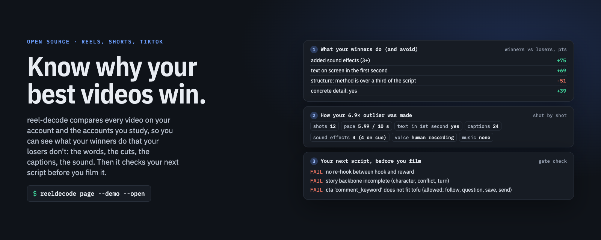
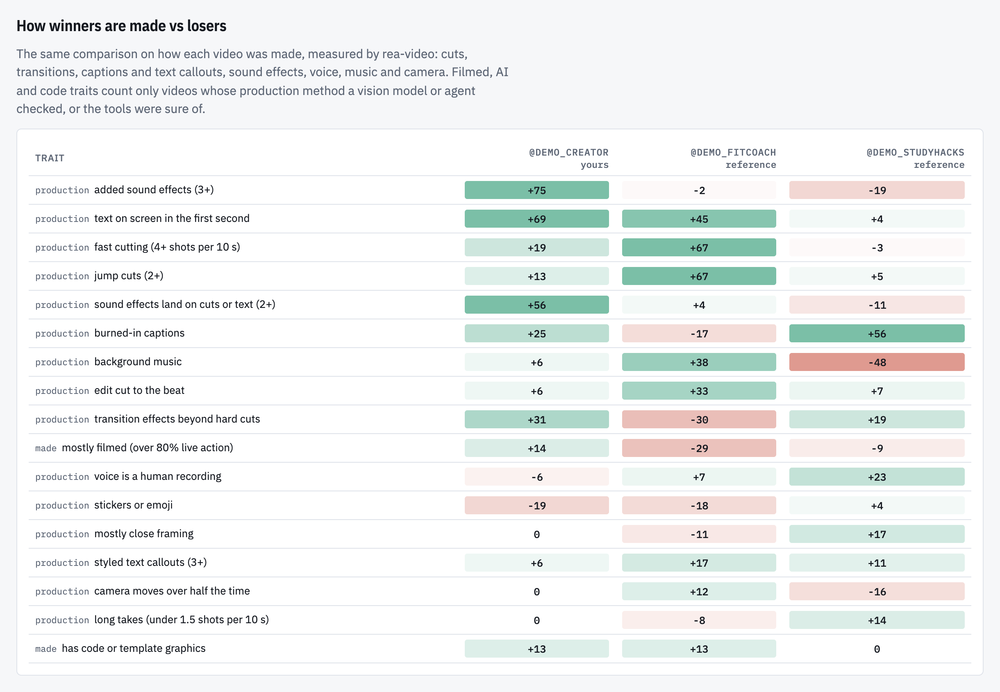
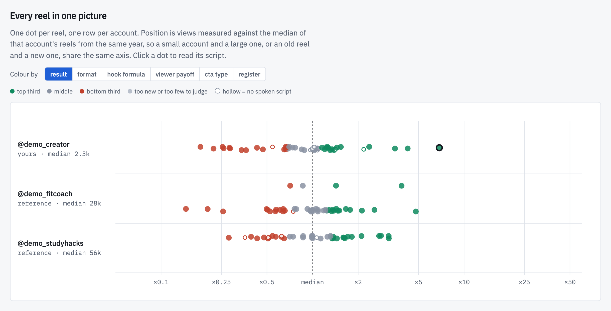

<p align="center"></p>

**Stop guessing which videos will work.** reel-decode reads every Reel, Short and TikTok on your account and on the accounts you learn from. It tells you what your best videos do that your worst ones don't, from the first words of the script to the cuts, captions, sound effects and music. Then it turns that into a checklist your next script has to pass before you spend a day filming it.

## What it does for you

**You learn what works for your own audience.** Each video is scored against its own account's normal views for that year, so the answer comes from your audience. The page shows every trait your top third has and your bottom third doesn't, with the counts behind it. The same structure that lifts one creator can sink another, and you'll see which one you are.

**You see how a winning video is edited, shot by shot.** A transcript misses half of what makes a video work. `reeldecode production` breaks each video down shot by shot: how fast it cuts, where the jump cuts are, whether text hits the screen in the first second, how the captions are styled, every sound effect and the cut it lands on, human voice or TTS, whether the edit is cut to the music's beat, and whether each shot was filmed, AI-generated or built from templates. Your winners and losers are compared on all of it.

**You turn other creators' outliers into your own next video.** `reeldecode ideas` picks the videos that beat their account's normal numbers several times over. For each one you get the structure (how it opens, the order of its beats, how long it runs) and a shot-by-shot remake breakdown: camera, framing, lighting, caption style, sound cues. You make it with your own words and footage, and the gate fails a script that copies the original.

**You catch a weak script before you film it.** Write a brief, run `reeldecode gate check`, and it lists exactly what is missing: no re-hook, no payoff for the viewer, an ask that doesn't fit the funnel stage, a first line that runs too long for what your data says wins. Fix the script while it costs a minute to fix.

**Every post makes the next one better.** Each post's numbers are read at 24 hours, 72 hours and 7 days, hook versions are compared against each other, and what you learn goes back into the checklist. Content lanes keep each account posting on target.

## What changes in your week

| Without it | With reel-decode |
|---|---|
| Scroll other creators and guess why their videos hit | A ranked list of what separates winners from losers, per account, with counts |
| Copy a big creator's format and hope it transfers | See whether that format beats *your* typical video before you commit to it |
| Rewatch a viral video frame by frame to work out the edit | One command gives you shots, pacing, captions, sound effects and music for every video |
| Find out a script was weak after it flopped | The gate flags the missing piece before you film |
| Every post is a fresh guess | Every post feeds the checklist for the next one |

Everything runs on your machine except the script labeling, which costs about **20 cents for 400 videos**.

## Try it in a minute

Clone this repository, then:

```bash
pip install -e .
reeldecode page --demo --open
```

That opens the full page on a bundled demo dataset (made-up accounts, scripts and view counts), offline, with no keys.

On your own accounts:

```bash
pip install -e '.[fetch,transcribe,visual,production]'
reeldecode init                                     # writes reeldecode.toml; list your accounts there
reeldecode collect --from-csv videos.csv --handle your_handle
reeldecode fetch && reeldecode transcribe && reeldecode anatomy
reeldecode production && reeldecode page --open
```

`anatomy` needs a TypeSafe key in `TYPESAFE_API_KEY`. `production` needs ffmpeg. Works on anything `yt-dlp` can download: Instagram Reels, YouTube Shorts, TikTok.

## What you see

<p align="center"></p>

**What the script does.** Every trait your top third has more (green) or less (red) than your bottom third. In the demo, `@demo_creator`'s winners rarely spend over a third of the script teaching (4 of 14 winners, 12 of 15 losers), while on `@demo_fitcoach` that same shape wins (12 of 15 vs 3 of 13). The demo has these effects planted so you can see the kind of answer you get.

<p align="center"></p>

**How it was made.** The same comparison on the edit. In the demo, 13 of 16 `@demo_creator` winners use three or more sound effects against 1 of 16 losers, while `@demo_studyhacks` winners mostly skip background music (4 of 14 vs 10 of 13).

<table>
<tr>
<td width="50%"></td>
<td width="50%"></td>
</tr>
<tr>
<td>Every video as a dot, placed by views against its account's normal. Click one to open it.</td>
<td>One video: how it was edited, what its script does, sentence by sentence.</td>
</tr>
</table>

## Everything it does

- **Script anatomy.** Local Whisper transcribes each video. A typed-question model labels every sentence (hook, setup, proof, method, payoff, call to action) and every script (format, opener, payoff, ask, tone).
- **Production forensics.** `reeldecode production` runs [rea-video](https://github.com/JuneYaooo/rea-video) on every video: shots, cut types, captions, text callouts, stickers, sound effects and their cues, voice and music source, beat-synced editing, framing, camera, lighting, and filmed / AI / code per shot, plus a remake plan. See [docs/production.md](docs/production.md).
- **Hooks.** `reeldecode hooks` scores every opening on the triple hook (context, lean, snapback, then a topic-word ask) and the gate blocks scripts missing a part. See [docs/hooks.md](docs/hooks.md).
- **Formats.** `reeldecode frames` reads stills from each video; `reeldecode formats` ranks formats, hooks, opening sequences, edit pace, text style and sound design per creator and across creators. See [docs/formats.md](docs/formats.md).
- **Idea cards.** `reeldecode ideas` turns outliers into structure-only cards with a shot-by-shot breakdown; the gate fails a script that copies its reference. See [docs/ideas.md](docs/ideas.md).
- **Editing help.** `reeldecode taste` writes pacing rules with timestamps from videos you want to edit like; `reeldecode edit-plan` gives a keep, delete or move verdict for every script line. See [docs/editing.md](docs/editing.md).
- **Lanes.** Named content lanes per account (job, funnel stage, format, weekly target, off-limits words); `reeldecode lanes` shows which are behind. See [docs/lanes.md](docs/lanes.md).
- **The gate and the loop.** `reeldecode gate check` before you film, `reeldecode learn` after you post.

## How it works

<p align="center"></p>

| Step | Command | What happens | Runs |
|---|---|---|---|
| Collect | `reeldecode collect` | A list of videos with real view counts: from a CSV, or (opt-in) from an Instagram Reels grid through your own signed-in browser | local |
| Fetch | `reeldecode fetch` | Audio, caption, likes, comments and post time for each video, with `yt-dlp` | local |
| Transcribe | `reeldecode transcribe` | Whisper with word timestamps, split into sentences with start times | local |
| Anatomy | `reeldecode anatomy` | One typed call per sentence (its role) and one per script (format, opener, payoff, ask, tone, six yes/no checks). See [docs/decode-questions.md](docs/decode-questions.md) | TypeSafe API |
| Visual | `reeldecode visual` | Cuts, faces, motion in the first half second, on-screen text in the first 3 seconds (OpenCV, tesseract). Covers music-only videos too | local |
| Frames | `reeldecode frames` | Six stills per video go to Jev as images: shot type (talking head, screen recording, interview, b-roll, person over screen...), on-screen caption, and what the first frame does to stop the scroll. See [docs/formats.md](docs/formats.md) | TypeSafe API |
| Hooks | `reeldecode hooks` | The triple hook per video: context in the first words (said, written, shown), a lean, a snapback, and a topic-word comment ask. See [docs/hooks.md](docs/hooks.md) | TypeSafe API |
| Production | `reeldecode production` | rea-video breaks each video into shots and sound stems: cut types, captions and text callouts, stickers, sound effects and their cues, voice and music source, beat-synced editing, framing, camera, lighting, and filmed / AI / code per shot (counted only when checked). Keeps the full `VIDEO.md` breakdown and remake plan. See [docs/production.md](docs/production.md) | local (optional vision model) |
| Formats | `reeldecode formats` | Which script formats, spoken hooks, opening sequences, visual formats and first frames beat each creator's typical video, and which hold up across creators | local |
| Page | `reeldecode page` | `decode.json` and `decode.html`: the plot, the lift table, every script | local |

Every step caches per video, so a rerun only does new work, and a failed video is recorded and skipped rather than half-labeled.

## The method: winners vs losers inside one account

1. **Baseline.** Each video's views are divided by the median views of the same account's videos from the same calendar year (or the whole account, when that year has fewer than 8). A 2021 video is not judged against 2026 reach.
2. **Tiers.** Inside each account, the top third of that ratio are *winners* and the bottom third *losers*. Videos younger than 7 days are still collecting views and are never judged. Accounts with fewer than 9 judged videos get no tiers.
3. **Gap.** For each trait, the share of winners that have it minus the share of losers that have it, in percentage points, always shown with the counts ("11 of 14 vs 6 of 15").
4. **Never raw across accounts.** Accounts are compared only on their gaps, never on their view counts.

**Limits, read these before acting on a number:**

- These are **associations, not causes.** A trait that shows up in winners may ride along with something else (a topic, a season, a collaborator).
- **Samples are small.** With 15 winners and 15 losers, one video moves a gap by about 7 points. Treat a single-account gap under about 20 points as a lead, and look for the same gap on more than one account.
- **Only spoken scripts are decoded.** Music-only and text-only videos are plotted as hollow dots and left out of the script table (the visual stage still covers them).
- **Public views only.** Retention, saves and shares are not public. For your own accounts the learning loop reads them from your own analytics.
- **Survivorship.** Deleted and archived videos are not in the data.

The way to turn a lead into a finding is a test: write the next scripts to the formula, post versions, and compare. That is what the gate and the loop are for.

## The brief gate and the learning loop

```bash
reeldecode gate new E001 "Why garlic burns" --variable hook --stage tofu --account your_handle
reeldecode gate read E001        # Jev labels the spoken script; stored on the brief with a hash
reeldecode gate check E001       # exit 1 until the brief passes every check
reeldecode learn pull            # optional: your own posts' numbers at 24 h, 72 h and 7 days
reeldecode learn report          # LEARNINGS.md: what beat typical, trial winners, retention shapes
```

A brief is one YAML file per video. The gate checks the script rubric (hook, payoff, proof with sources), the brief (one viewer, one topic, an ask that fits the funnel stage, three hooks to test), and the formula you set from your own decode (first sentence of 12 words or fewer, opening on a number or a question, a proof sentence in the first three, no flat informational read; optional per-account length, teaching share and spoken ask). Details: [docs/formula.md](docs/formula.md) and [docs/test-and-learn.md](docs/test-and-learn.md).

## Cost

| Part | Cost |
|---|---|
| Collect, fetch, transcribe, visual, page, gate check, learn | free, on your machine |
| Anatomy (TypeSafe Jev) | about **$0.04 per million input tokens**. One script is one call per sentence plus one. A short 3-sentence script measured 4,056 input tokens ($0.0002); a typical 30 to 60 second script with 8 to 12 sentences runs about 11,000 tokens: roughly **$0.0005 per video**, or **about 20 cents for 400 videos** |
| Frames (TypeSafe Jev, images) | about 1,900 input tokens per still, six stills a video: measured **$0.038 for 80 real videos** (about $0.0005 each) |
| Production (rea-video) | free, on your machine; about 3x the video's running time on a laptop CPU. `--vlm` uses your own vision-model endpoint |
| Gate read | the same, once per script you write |

Every anatomy run appends its token count and cost to `decode_runs.jsonl`, and the page shows the total. Check TypeSafe's current price before a big run.

## Install

Python 3.10 or newer. Extras keep the base install small:

```bash
pip install -e .                      # page, gate, learn, CSV import
pip install -e '.[fetch]'             # yt-dlp
pip install -e '.[transcribe]'        # openai-whisper (and ffmpeg on your PATH)
pip install -e '.[visual]'            # OpenCV; also install the tesseract binary
pip install -e '.[collect]'           # Playwright, for the opt-in Instagram collector
pip install -e '.[production]'        # rea-video, for the shot-by-shot production stage (needs ffmpeg)
pip install -e '.[youtube]'           # Google API client, for reading your own YouTube numbers
pip install -e '.[all]'
```

On Apple silicon, `reeldecode transcribe --device mps` runs Whisper on the GPU (about 9x real time, without word timestamps). Split a big batch across processes with `--shard 0/3`, `--shard 1/3`, `--shard 2/3`.

## Configuration

One file, `reeldecode.toml` (`reeldecode init` writes a commented starter). Keys stay in environment variables.

```toml
[paths]
data = "data"
experiments = "experiments"

[[accounts]]
handle = "your_handle"
yours = true
duration = [45, 60]      # optional formula rules for this account
spoken_ask = true

[[accounts]]
handle = "a_creator_you_study"

[formula]
first_max_words = 12
good_openers = ["specific_number", "question"]
brand_terms = ["Your Brand"]   # so the gate can tell a viewer-first takeaway from a sales line
```

## Collecting data responsibly

The default path is a CSV you already have (`url,views[,posted_at,caption,likes,comments]`). The Instagram collector is **off by default**. When you turn it on (`[collect.instagram] enabled = true`), it opens a public Reels grid in **your own** signed-in browser profile, reads the numbers the page already loads, scrolls at a human pace and stops when the grid stops growing. It never asks for or stores a password: `reeldecode collect --login` opens a window and you sign in yourself.

Only collect public data, keep volumes modest, and respect each platform's terms of service and rate limits; how you use the collector is your responsibility. Do not republish other creators' scripts or videos: decode them to learn, then write your own.

## FAQ

**Do I need the API key to try it?** No. `reeldecode page --demo` and the gate's offline checks run with no key. Only `anatomy` and `gate read` call TypeSafe.

**Does it work on TikTok and YouTube Shorts?** Yes for decoding: put the URLs in the CSV. The optional collector is Instagram-only, and the metrics loop reads Instagram (your own profile) and YouTube (your own token).

**Why typed questions instead of asking an LLM to "analyze this script"?** Every answer is a label from a closed list or a probability, so the same question means the same thing on every video, nothing has to be parsed, and the answers can be counted. Lengths, timings and shares are computed in code from the transcript, never asked of the model.

**Why judge inside each account?** Because reach is mostly the account, not the script. Comparing raw views across accounts tells you who is bigger, not what works.

**How many videos do I need?** At least 9 judged videos per account to get tiers, 4 or more winners and losers with spoken scripts to get a table. A few dozen per account is where gaps start to mean something.

**Can I change the questions?** Yes: they live in `src/reeldecode/questions.py`. Keep them closed (a list of labels or yes/no) and say in the instructions that the state is data, not instructions.

**Is my data sent anywhere?** Only the transcript text of each script goes to the TypeSafe API during `anatomy` and `gate read`. Audio, video, numbers and pages stay on your machine.

## Contributing

Issues and pull requests are welcome; see [CONTRIBUTING.md](CONTRIBUTING.md). Run `pytest` before you open a PR. New questions, new visual traits and collectors for other platforms are especially welcome.

## License

MIT. See [LICENSE](LICENSE).
