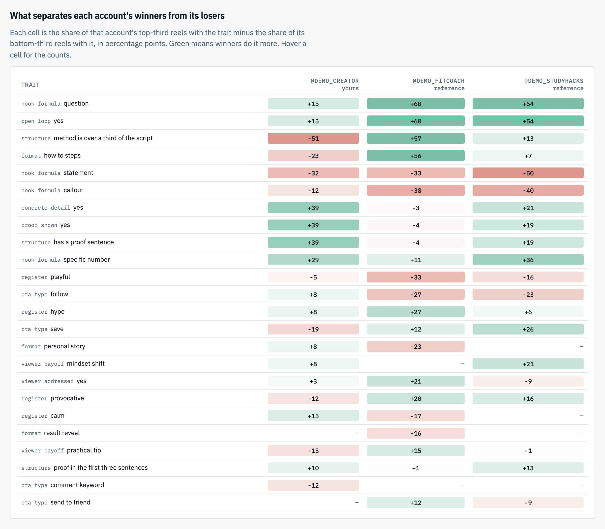
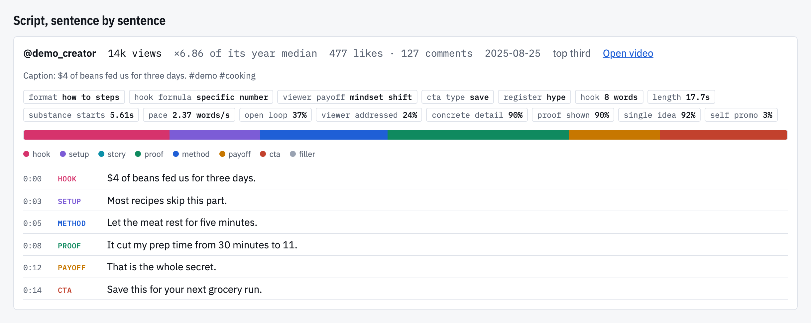
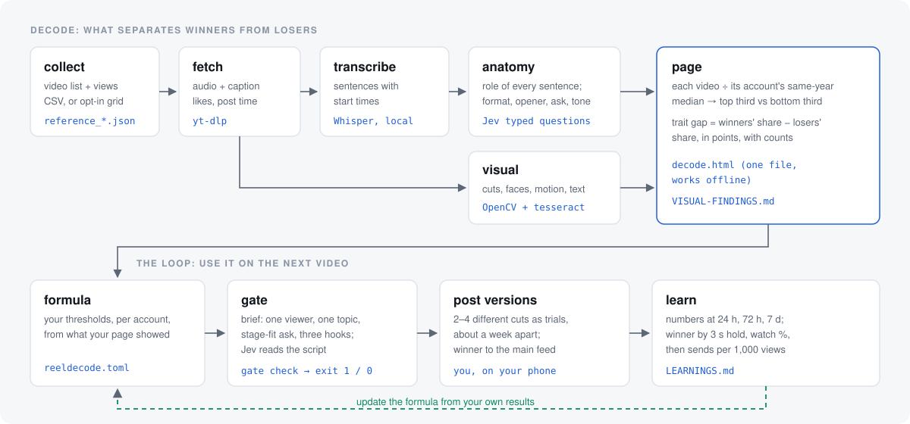

<p align="center"></p>

**reel-decode** reads every short video on an account, labels what each sentence of the script is doing, measures what is on screen, and shows you which choices your best videos make that your worst ones don't. Then it checks your next script against what you found, before you film it.

- **Script anatomy.** Local Whisper transcribes each video. A typed-question model labels every sentence (hook, setup, proof, method, payoff, call to action) and every script (format, opener, payoff, ask, tone). No free-text parsing.
- **Fair comparisons.** Each video is judged against its own account's median for the same year. A 300-view account and a 300,000-view account can be compared on what separates their good videos from their bad ones.
- **One interactive page.** Every video as a dot, a winners-vs-losers table per account, and each script sentence by sentence. A single HTML file that works offline.
- **From findings to an edit.** `reeldecode taste` writes a taste book (pacing rules with timestamps) from reference videos you want to edit like; `reeldecode edit-plan` gives a keep, delete or move verdict for every script line. See [docs/editing.md](docs/editing.md).
- **Score hooks on the triple hook.** Context, lean, snapback, then a topic-word ask: `reeldecode hooks` scores every video 0 to 3, `formats` shows whether higher scores beat each creator's typical video, and the gate blocks scripts missing a part. See [docs/hooks.md](docs/hooks.md).
- **What formats win, from frames and words.** `reeldecode frames` has Jev look at stills from each video; `reeldecode formats` ranks formats, hooks and opening sequences per creator and across creators, each against that creator's own typical video. See [docs/formats.md](docs/formats.md).
- **From outliers to your own idea.** `reeldecode ideas` turns the videos that beat their account's normal numbers into idea cards (structure, not wording); the gate fails a script that copies its reference. See [docs/ideas.md](docs/ideas.md).
- **Lanes, so it ships every week.** Give each account named content lanes (job, funnel stage, format, weekly target, off-limits words); the gate checks every brief against its lane and `reeldecode lanes` shows which are behind. See [docs/lanes.md](docs/lanes.md).
- **A gate for the next script.** Turn the findings into checks (`reeldecode gate check`) and a test-and-learn loop that reads each post's numbers at 24 h, 72 h and 7 days.

Works on Instagram Reels, YouTube Shorts and TikTok: anything `yt-dlp` can download.

## Quickstart

Clone this repository, then:

```bash
pip install -e .
reeldecode page --demo --open
```

That opens the decode page on a bundled **synthetic** dataset (made-up accounts like `@demo_creator`, made-up scripts and view counts) so you can see the output in under a minute, offline, with no keys.

To run it on real accounts:

```bash
pip install -e '.[fetch,transcribe,visual]'
reeldecode init                                     # writes reeldecode.toml; list your accounts there
reeldecode collect --from-csv videos.csv --handle your_handle
reeldecode fetch && reeldecode transcribe && reeldecode anatomy && reeldecode page --open
```

`anatomy` needs a TypeSafe key in `TYPESAFE_API_KEY`. Everything else runs on your machine.

## What you get

<p align="center"></p>

**Sample finding (synthetic demo data).** On `@demo_creator`, scripts that spend over a third of their sentences teaching sit in 4 of 14 winners but 12 of 15 losers (**−51 points**). On `@demo_fitcoach` the same shape is in 12 of 15 winners and 3 of 13 losers (**+57**). A flat statement as the opener loses on all three accounts. The demo data is generated with these effects planted on purpose; it shows the kind of answer the tool gives, not a real result. The lesson it illustrates did show up in real data: the script shape that lifts one account can sink another, so copying a bigger creator's structure is a test, not a plan.

<table>
<tr>
<td width="50%"></td>
<td width="50%"></td>
</tr>
<tr>
<td>Every video as a dot, placed by views against its account's same-year median. Click one to read it.</td>
<td>Each script sentence by sentence, colored by the job it does, with the labels and timings.</td>
</tr>
</table>

## How it works

<p align="center"></p>

| Step | Command | What happens | Runs |
|---|---|---|---|
| Collect | `reeldecode collect` | A list of videos with real view counts: from a CSV, or (opt-in) from an Instagram Reels grid through your own signed-in browser | local |
| Fetch | `reeldecode fetch` | Audio, caption, likes, comments and post time for each video, with `yt-dlp` | local |
| Transcribe | `reeldecode transcribe` | Whisper with word timestamps, split into sentences with start times | local |
| Anatomy | `reeldecode anatomy` | One typed call per sentence (its role) and one per script (format, opener, payoff, ask, tone, six yes/no checks). See [docs/decode-questions.md](docs/decode-questions.md) | TypeSafe API |
| Visual | `reeldecode visual` | Cuts, faces, motion in the first half second, on-screen text in the first 3 seconds (OpenCV, tesseract). Covers music-only videos too | local |
| Frames | `reeldecode frames` | Six stills per video go to Jev as images: shot type (talking head, screen recording, interview, b-roll, person over screen...), on-screen caption, and what the first frame does to stop the scroll. See [docs/formats.md](docs/formats.md) | TypeSafe API |
| Hooks | `reeldecode hooks` | The triple hook per video: context in the first words (said, written, shown), a lean, a snapback, and a topic-word comment ask. See [docs/hooks.md](docs/hooks.md) | TypeSafe API |
| Formats | `reeldecode formats` | Which script formats, spoken hooks, opening sequences, visual formats and first frames beat each creator's typical video, and which hold up across creators | local |
| Page | `reeldecode page` | `decode.json` and `decode.html`: the plot, the lift table, every script | local |

Every step caches per video, so a rerun only does new work, and a failed video is recorded and skipped rather than half-labeled.

## The method: winners vs losers inside one account

1. **Baseline.** Each video's views are divided by the median views of the same account's videos from the same calendar year (or the whole account, when that year has fewer than 8). A 2021 video is not judged against 2026 reach.
2. **Tiers.** Inside each account, the top third of that ratio are *winners* and the bottom third *losers*. Videos younger than 7 days are still collecting views and are never judged. Accounts with fewer than 9 judged videos get no tiers.
3. **Gap.** For each trait, the share of winners that have it minus the share of losers that have it, in percentage points, always shown with the counts ("11 of 14 vs 6 of 15").
4. **Never raw across accounts.** Accounts are compared only on their gaps, never on their view counts.

**Limits, read these before acting on a number:**

- These are **associations, not causes.** A trait that shows up in winners may ride along with something else (a topic, a season, a collaborator).
- **Samples are small.** With 15 winners and 15 losers, one video moves a gap by about 7 points. Treat a single-account gap under about 20 points as a lead, and look for the same gap on more than one account.
- **Only spoken scripts are decoded.** Music-only and text-only videos are plotted as hollow dots and left out of the script table (the visual stage still covers them).
- **Public views only.** Retention, saves and shares are not public. For your own accounts the learning loop reads them from your own analytics.
- **Survivorship.** Deleted and archived videos are not in the data.

The way to turn a lead into a finding is a test: write the next scripts to the formula, post versions, and compare. That is what the gate and the loop are for.

## The brief gate and the learning loop

```bash
reeldecode gate new E001 "Why garlic burns" --variable hook --stage tofu --account your_handle
reeldecode gate read E001        # Jev labels the spoken script; stored on the brief with a hash
reeldecode gate check E001       # exit 1 until the brief passes every check
reeldecode learn pull            # optional: your own posts' numbers at 24 h, 72 h and 7 days
reeldecode learn report          # LEARNINGS.md: what beat typical, trial winners, retention shapes
```

A brief is one YAML file per video. The gate checks the script rubric (hook, payoff, proof with sources), the brief (one viewer, one topic, an ask that fits the funnel stage, three hooks to test), and the formula you set from your own decode (first sentence of 12 words or fewer, opening on a number or a question, a proof sentence in the first three, no flat informational read; optional per-account length, teaching share and spoken ask). Details: [docs/formula.md](docs/formula.md) and [docs/test-and-learn.md](docs/test-and-learn.md).

## Cost

| Part | Cost |
|---|---|
| Collect, fetch, transcribe, visual, page, gate check, learn | free, on your machine |
| Anatomy (TypeSafe Jev) | about **$0.04 per million input tokens**. One script is one call per sentence plus one. A short 3-sentence script measured 4,056 input tokens ($0.0002); a typical 30 to 60 second script with 8 to 12 sentences runs about 11,000 tokens: roughly **$0.0005 per video**, or **about 20 cents for 400 videos** |
| Frames (TypeSafe Jev, images) | about 1,900 input tokens per still, six stills a video: measured **$0.038 for 80 real videos** (about $0.0005 each) |
| Gate read | the same, once per script you write |

Every anatomy run appends its token count and cost to `decode_runs.jsonl`, and the page shows the total. Check TypeSafe's current price before a big run.

## Install

Python 3.10 or newer. Extras keep the base install small:

```bash
pip install -e .                      # page, gate, learn, CSV import
pip install -e '.[fetch]'             # yt-dlp
pip install -e '.[transcribe]'        # openai-whisper (and ffmpeg on your PATH)
pip install -e '.[visual]'            # OpenCV; also install the tesseract binary
pip install -e '.[collect]'           # Playwright, for the opt-in Instagram collector
pip install -e '.[youtube]'           # Google API client, for reading your own YouTube numbers
pip install -e '.[all]'
```

On Apple silicon, `reeldecode transcribe --device mps` runs Whisper on the GPU (about 9x real time, without word timestamps). Split a big batch across processes with `--shard 0/3`, `--shard 1/3`, `--shard 2/3`.

## Configuration

One file, `reeldecode.toml` (`reeldecode init` writes a commented starter). Keys stay in environment variables.

```toml
[paths]
data = "data"
experiments = "experiments"

[[accounts]]
handle = "your_handle"
yours = true
duration = [45, 60]      # optional formula rules for this account
spoken_ask = true

[[accounts]]
handle = "a_creator_you_study"

[formula]
first_max_words = 12
good_openers = ["specific_number", "question"]
brand_terms = ["Your Brand"]   # so the gate can tell a viewer-first takeaway from a sales line
```

## Collecting data responsibly

The default path is a CSV you already have (`url,views[,posted_at,caption,likes,comments]`). The Instagram collector is **off by default**. When you turn it on (`[collect.instagram] enabled = true`), it opens a public Reels grid in **your own** signed-in browser profile, reads the numbers the page already loads, scrolls at a human pace and stops when the grid stops growing. It never asks for or stores a password: `reeldecode collect --login` opens a window and you sign in yourself.

Only collect public data, keep volumes modest, and respect each platform's terms of service and rate limits; how you use the collector is your responsibility. Do not republish other creators' scripts or videos: decode them to learn, then write your own.

## FAQ

**Do I need the API key to try it?** No. `reeldecode page --demo` and the gate's offline checks run with no key. Only `anatomy` and `gate read` call TypeSafe.

**Does it work on TikTok and YouTube Shorts?** Yes for decoding: put the URLs in the CSV. The optional collector is Instagram-only, and the metrics loop reads Instagram (your own profile) and YouTube (your own token).

**Why typed questions instead of asking an LLM to "analyze this script"?** Every answer is a label from a closed list or a probability, so the same question means the same thing on every video, nothing has to be parsed, and the answers can be counted. Lengths, timings and shares are computed in code from the transcript, never asked of the model.

**Why judge inside each account?** Because reach is mostly the account, not the script. Comparing raw views across accounts tells you who is bigger, not what works.

**How many videos do I need?** At least 9 judged videos per account to get tiers, 4 or more winners and losers with spoken scripts to get a table. A few dozen per account is where gaps start to mean something.

**Can I change the questions?** Yes: they live in `src/reeldecode/questions.py`. Keep them closed (a list of labels or yes/no) and say in the instructions that the state is data, not instructions.

**Is my data sent anywhere?** Only the transcript text of each script goes to the TypeSafe API during `anatomy` and `gate read`. Audio, video, numbers and pages stay on your machine.

## Contributing

Issues and pull requests are welcome; see [CONTRIBUTING.md](CONTRIBUTING.md). Run `pytest` before you open a PR. New questions, new visual traits and collectors for other platforms are especially welcome.

## License

MIT. See [LICENSE](LICENSE).
